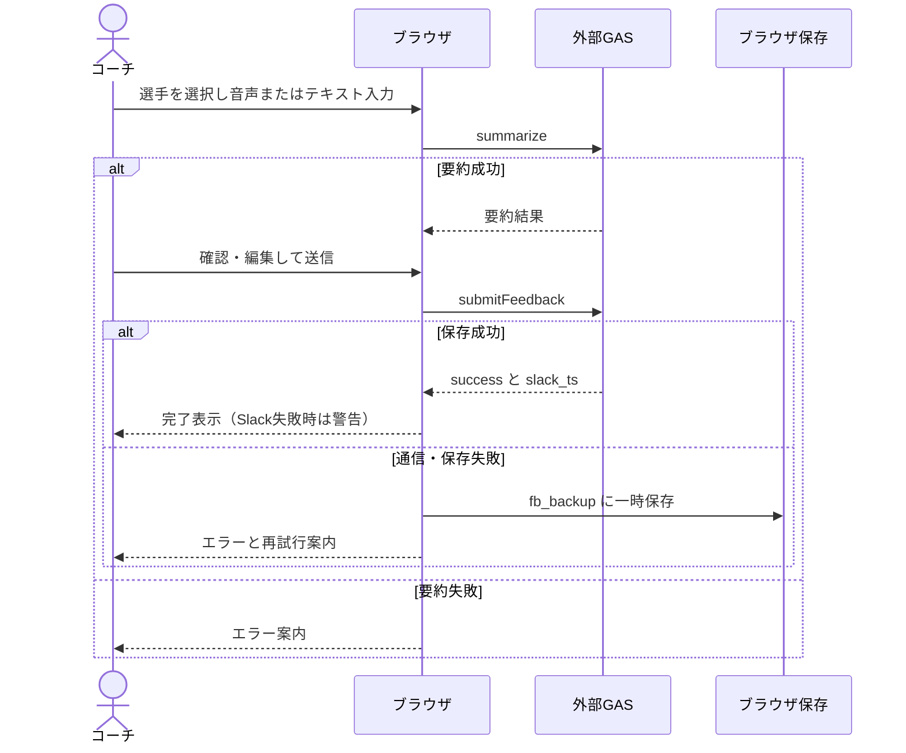
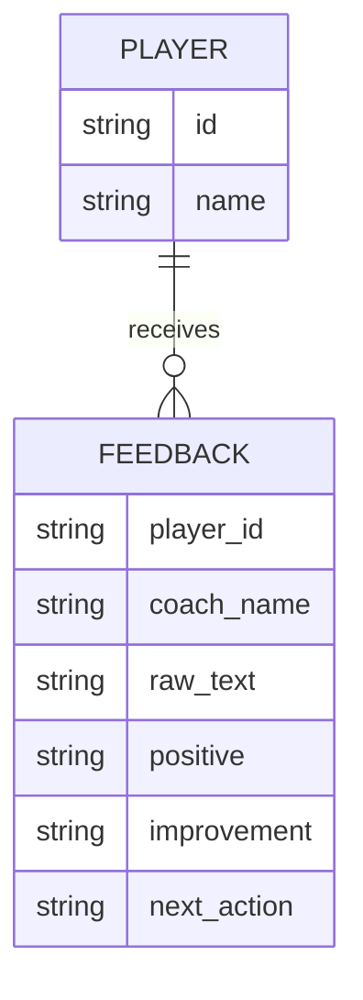

# FB Studio - 京大サッカー部

選手へのフィードバックを音声またはテキストで入力し、要約を確認・編集して送信するWebフロントエンドです。

[公開画面を開く](https://sofardogood.github.io/fb-studio/)

## 実装範囲と外部依存

- 本リポジトリはHTML・CSS・JavaScriptをまとめた [index.html](index.html) とGitHub Pages配信設定を管理します。
- 選手・コーチ選択、音声認識、手入力、要約編集、送信、履歴表示を実装しています。
- データ取得・要約・保存・Slack連携は外部のGoogle Apps Script（GAS）に依存します。GAS側コードと認証・データストア設定はこのリポジトリには含まれません。
- 公開画面が表示されることと、GAS・AI・Sheets・Slackの接続が正常であることは別です。実データを使った送信試験は今回実施していません。

## 構成と主要フロー（UMLシーケンス図）



GAS内部で実際に利用するAIモデル・Sheets構成・Slack投稿処理は未確認であり、上図はブラウザから確認できる境界までを示します。

## データと保存

| 保存先 | 内容 | 注意 |
|---|---|---|
| sessionStorage | コーチ名、選手一覧キャッシュ | 同一タブのセッション内 |
| localStorage | 送信失敗時のフィードバック一時保存（fb_backup） | 共有端末では利用後の残存に注意 |
| 外部GAS | 選手・コーチ・履歴取得、要約、送信 | サーバー側保存・権限は別途確認が必要 |

DBスキーマがこのrepoにないため、外部DBのER図は確定できません。以下はブラウザ送信データの論理関係であり、外部DB設計ではありません。



## ローカル確認と配信

ビルド・npm依存はありません。ローカルでは静的HTTPサーバーを使用します。

```sh
python3 -m http.server 8000
```

http://localhost:8000/ を開きます。音声認識は対応ブラウザとマイク許可が必要です。非対応時は手入力へ切り替えます。

配信手順の正本は [.github/workflows/pages.yml](.github/workflows/pages.yml) です。接続先はindex.htmlのGAS_URLで指定されます。接続先や権限変更は別途承認のうえ実施してください。認証情報はHTMLに埋め込まないでください。

## 検証と運用上の注意

- ソース照合：要約・送信・履歴・ローカル退避の処理を確認。
- 文書修正時：GitHubのmainを再取得し、説明文・リンク・図と実装の対応を確認。
- 未検証：マイク入力、実AI応答、実データ保存、Slack到達、再送時の重複防止。
- 実運用の受入試験では、許可されたテストデータ・テスト宛先を使い、成功・失敗・通信中断・復旧を確認します。画面を開くだけでも既存バックアップ再送処理が動くため、本番データのあるブラウザでの不用意な試験を避けてください。

作業記録：[docs/work-log/2026-11-09.md](docs/work-log/2026-11-09.md)
